

  

<h1 align="center">Peki</h1>

  <b>Personal AI agents, right in your Mac's menu bar.</b> 
  Give each agent a name, a face and a job. They work with your notes, only as much as you allow, 
  and run on your Mac by default.

  

  
  
  
  
  

  <a href="https://getpeki.app">Website</a> ·
  <a href="https://getpeki.app/use-cases/">Use cases</a> ·
  <a href="https://github.com/erdogankesgin/pekiapp/releases">Release notes</a> ·
  <a href="https://getpeki.app/support/">Support</a>

 

  

##  Agents with a name, a face and a job

Each agent is a small character you set up in a minute. Tell it what you need: it keeps that role, remembers what
matters and works with the tools you allow.

<table>
<tr>
<td width="46%"></td>
<td>

**Made from one sentence.** Describe the agent and Peki suggests a name, a personality and a face. Change any part,
the color or the background.

**A face that reacts.** It blinks and looks around, reads while it works and looks up when it needs your OK.

**Notes, only as you allow.** No access, read, or read and change. Every change shows up in the chat with an Undo.

**A memory you can edit.** It remembers what you tell it to keep. Read, change or erase it anytime.

**Always one click away.** Up to three agents get their own circle in the menu bar, next to Peki, the built-in notes
agent. Chat in a small panel, or pop the chat out into its own window.

</td>
</tr>
</table>

##  Agents that use your Mac

<b data-version>New in 0.9.19.</b> Turn on "Computer" for an agent and it opens your apps, clicks, types and uses menus for
you. The app stays in the background, your mouse stays put, and the agent's own cursor shows what it's doing.

  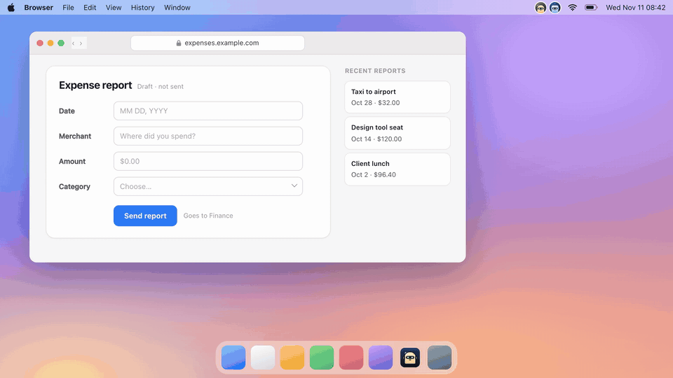

<table>
<tr>
<td width="33%" valign="top"><b>Works in the background</b> It reads the window and presses buttons without bringing the app forward or moving your pointer. A cursor with the agent's face shows where it clicks.</td>
<td width="33%" valign="top"><b>Menus, text and drags</b> It runs menu commands, selects and replaces text, moves files into folders in Finder and expands rows. It checks that what it typed actually landed.</td>
<td width="33%" valign="top"><b>Web pages too</b> It clicks and scrolls in Chrome and Safari. If the window is on another desktop it switches there through the Dock and comes back when done.</td>
</tr>
<tr>
<td width="33%" valign="top"><b>Sees the screen, if you want</b> With "See the screen too", an agent on a model that can see images looks at the window's picture and clicks by position.</td>
<td width="33%" valign="top"><b>Asks before it matters</b> Deleting, sending or buying needs your OK every time. Password fields, password managers, System Settings and terminals are off-limits.</td>
<td width="33%" valign="top"><b>Only the apps you pick</b> Off by default, per agent, with the Accessibility permission. Limit an agent to a few apps; anything else shows an approval card first.</td>
</tr>
</table>

  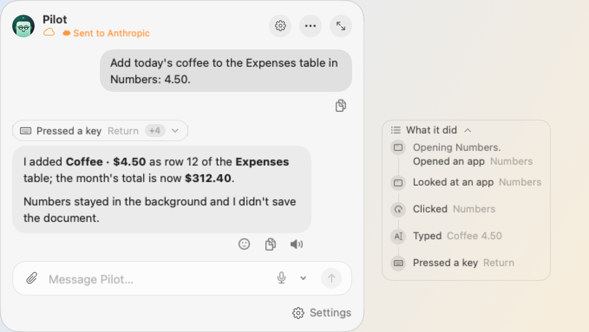

##  Agents that make things

Ask for a page, a deck or a spreadsheet and get a real file: in its own folder, ready
to open, with an Undo.

  

<table>
<tr>
<td width="33%" valign="top"><b>Pages and decks</b> A landing page or a slide deck in one file. It checks the page at desktop and phone width and fixes what it finds.</td>
<td width="33%" valign="top"><b>Word, Excel, PowerPoint</b> Documents, spreadsheets with formulas and 16:9 decks that open in Office, Pages, Numbers and Keynote.</td>
<td width="33%" valign="top"><b>PDF tools</b> Merge, split, rotate, watermark, fill in forms, or read the number off a scanned invoice.</td>
</tr>
<tr>
<td width="33%" valign="top"><b>Images and GIFs</b> Crop, resize, convert or remove a background on this Mac. Make a social image or a small animated GIF.</td>
<td width="33%" valign="top"><b>Reads your files</b> Hand it a Word, Excel, PowerPoint or PDF file and it reads the tables, the slides and the speaker notes.</td>
<td width="33%" valign="top"><b>Its own folder</b> It works only in its folder inside the one you pick and runs no commands. Every change has an Undo; deleted files come back for 7 days.</td>
</tr>
</table>

##  Hand off the routine

Agents work on a schedule or when you ask, and leave the result where you'll see it.

<table>
<tr>
<td>

**Just ask.** "Every weekday at 9, brief me" sets up the job. "Make it 10" moves it, "pause it for a while" pauses
it. Each change is a chip you can undo.

**Any rhythm.** Every day, weekdays, once a week, every few hours, or once at a set time. Or set it up yourself in
the agent's Jobs list.

**Hand over a note.** Right-click a note and choose Assign to an Agent. Files you attach go along with the job.

**Meeting notes.** Record a meeting. It is transcribed on this Mac, and an agent writes down the decisions and action
items.

**Results where you want them.** In the chat, in your notes, or as a sticky note on your Shelf, with a bubble under the
agent's face and a notification you can reply to.

</td>
<td width="46%">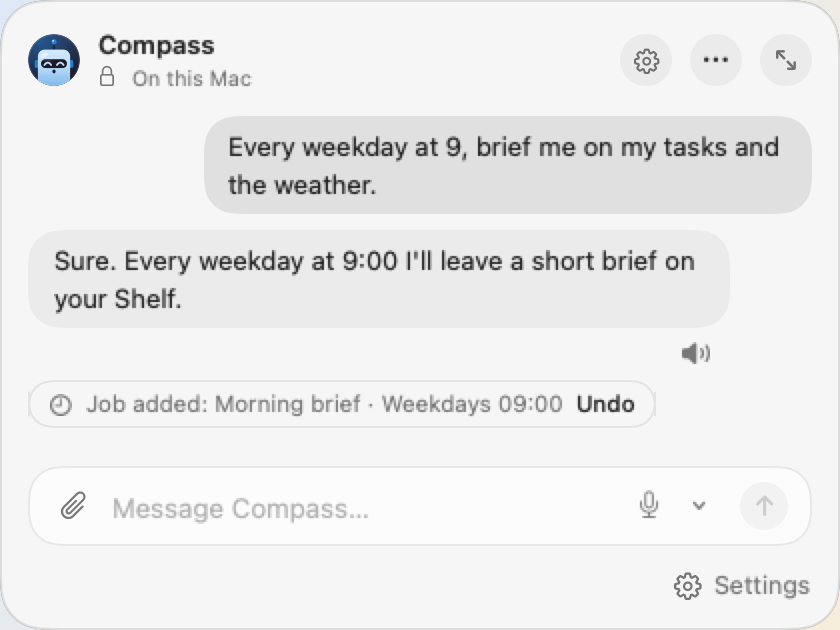</td>
</tr>
</table>

##  Your calendar, reminders and mail

Turn them on per agent. Peki reads them from the apps on this Mac; it never connects to
Google or your mail server.

  

<table>
<tr>
<td width="33%" valign="top"><b>Calendar</b> Reads the calendars on this Mac (iCloud, Google, Outlook), finds free time and adds events when you ask.</td>
<td width="33%" valign="top"><b>Reminders</b> Adds reminders with a time and checks them off. They reach your iPhone through iCloud.</td>
<td width="33%" valign="top"><b>Mail</b> Reads and summarizes Apple Mail and opens reply drafts for you. It can't send, delete or move a message.</td>
</tr>
</table>

##  Talk to your agents

Agents can answer out loud while their face talks along. Or go hands-free: say the agent's name and ask.

<table>
<tr>
<td width="46%">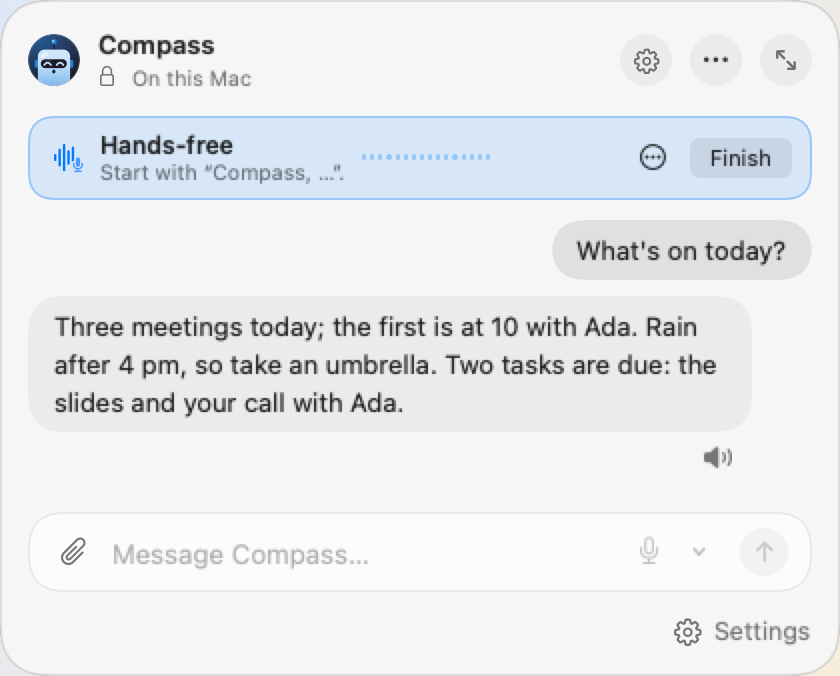</td>
<td>

**Replies read aloud.** After a voice message, always, or when you press 🔊. Pick the voice, speed and pitch for each
agent. The first sentence plays while the rest of the reply is still coming.

**Hands-free.** Right-click an agent in the menu bar and choose Talk Hands-Free. Start with its name: "Compass,
what's on today?" Say the name while it's talking and it stops to listen.

**Made on this Mac.** Voices and transcription run on your Mac. Gemini's voices are optional, per agent, and clearly
marked.

**The mic is yours.** It turns on only when you start, and stops when you finish or after three quiet minutes.

</td>
</tr>
</table>

##  Agents that work together

Your agents can ask each other, share out the work and talk things over in rooms.

  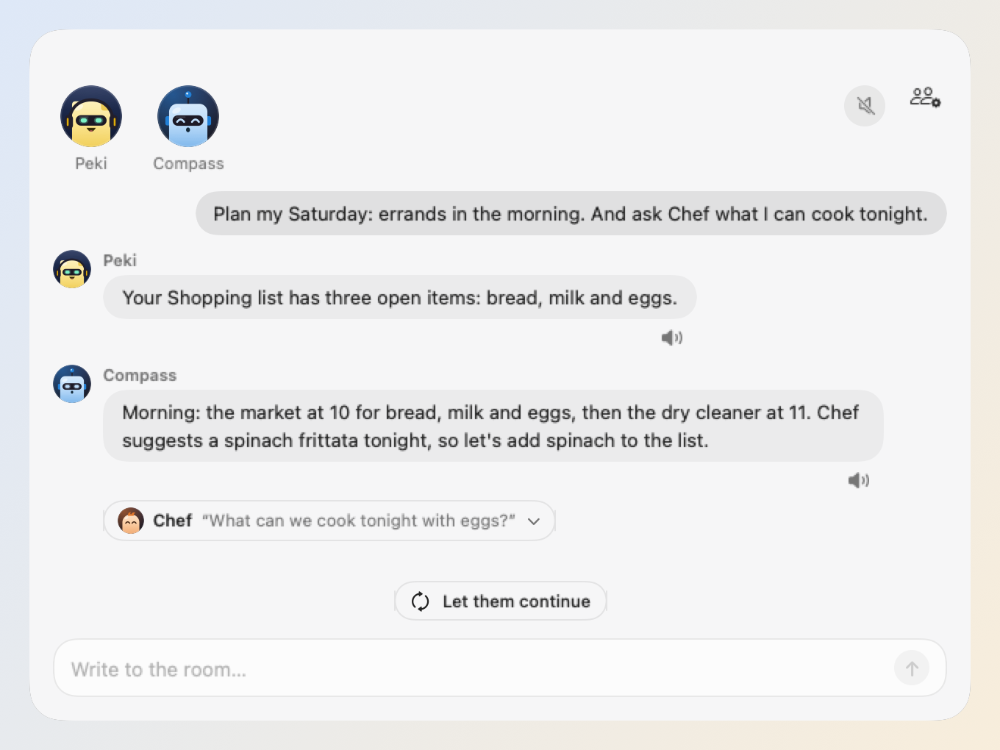

<table>
<tr>
<td width="33%" valign="top"><b>Ask another agent</b> An agent asks the one that knows: "Ask Chef what we can cook tonight." The one asked only reads, and Peki checks with you before your notes reach another company.</td>
<td width="33%" valign="top"><b>Share out the work</b> On larger models an agent can give parts of a job to your other agents, run them at the same time and bring the results together.</td>
<td width="33%" valign="top"><b>Hand off a job</b> When a job is done, its result can go to another agent: Scribe writes the meeting notes, Compass pulls out the tasks, in one note.</td>
</tr>
<tr>
<td width="33%" valign="top"><b>Rooms that chat</b> Several rooms, each with its own agents and topic. The best-suited agent answers; call one by name, or say "everyone".</td>
<td width="33%" valign="top"><b>Tasks and design reviews</b> A Tasks room has a lead who hands out work. In a Design review one agent drafts, the others critique, and the design you approve lands on your Shelf.</td>
<td width="33%" valign="top"><b>Reactions and small talk</b> When an emoji is enough, they react instead of replying. Let them chat among themselves for a few turns, and "Summarize" leaves the gist on your Shelf.</td>
</tr>
</table>

##  Internet, skills and connections

Turned on per agent, and off until you do. A tool that changes something waits for your OK.

  
  &nbsp;
  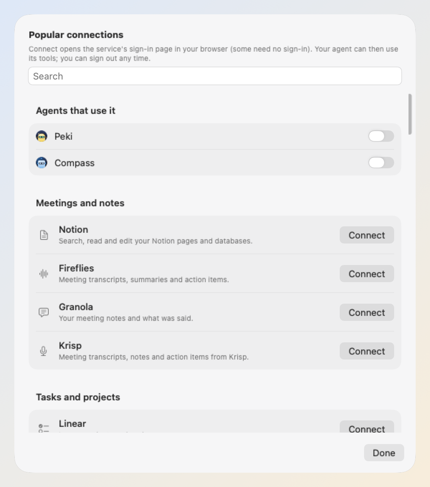

<table>
<tr>
<td width="25%" valign="top"><b>The web</b> Search and read pages. Instructions written on pages are not followed.</td>
<td width="25%" valign="top"><b>Connections</b> 53 ready-made MCP servers like Notion, Linear or Fireflies, or any other. Connect signs you in through your browser.</td>
<td width="25%" valign="top"><b>Skills</b> 28 ready-made skills, any from skills.sh, or your own <code>SKILL.md</code>. A skill's connection is set up only with your OK.</td>
<td width="25%" valign="top"><b>Asks before it acts</b> Tools that only read run without asking. Allow a tool for one agent, for all, or for one job.</td>
</tr>
</table>

<a href="https://getpeki.app/connections/">More on connections and skills →</a>

##  Your model, your choice

Every agent can use a different model. Start with the one already on your Mac.

<table>
<tr><td><b>Built in</b></td><td>Apple's on-device model</td><td>Free, private, works offline. The default.</td></tr>
<tr><td><b>Local server</b></td><td>Ollama · LM Studio</td><td>Bigger open models, still on your network.</td></tr>
<tr><td><b>Your API key</b></td><td>Claude · OpenAI · Gemini</td><td>Keys stay in your Keychain.</td></tr>
<tr><td><b>Your subscription</b></td><td>Claude Code · Codex · Gemini CLI · OpenCode · Cursor Agent</td><td>Use the plan you already pay for.</td></tr>
</table>

##  Your notes, at the edge of your screen

The Shelf is a slim glass strip at the side of your screen. Point at it and your notes slide out; click one to open
it. Your agents' results land here too.

  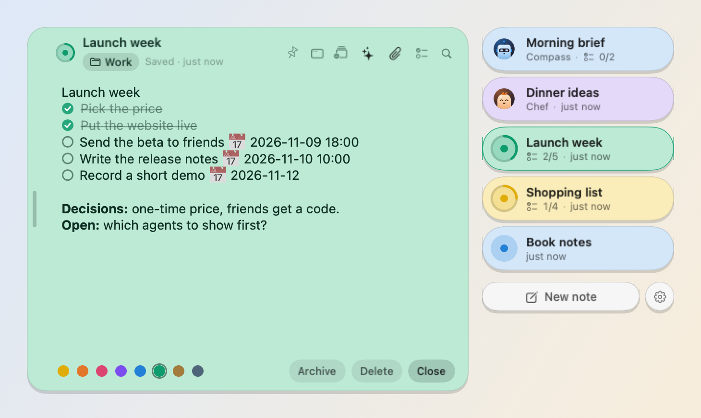

<table>
<tr>
<td width="33%" valign="top"><b>Tasks with dates</b> A line that starts with <code>- [ ]</code> is a task. Type "tomorrow at 10" and it becomes a reminder.</td>
<td width="33%" valign="top"><b>Always within reach</b> Open a note without switching apps, tear it off to keep it on screen, or turn the Shelf off.</td>
<td width="33%" valign="top"><b>Voice and files</b> Record audio straight into a note, or add PDFs and images. Recordings are transcribed on this Mac.</td>
</tr>
</table>

##  Every note in one window

Folders, tags and search for when the Shelf isn't enough. Ask an agent about the note you're reading, right next to it.

  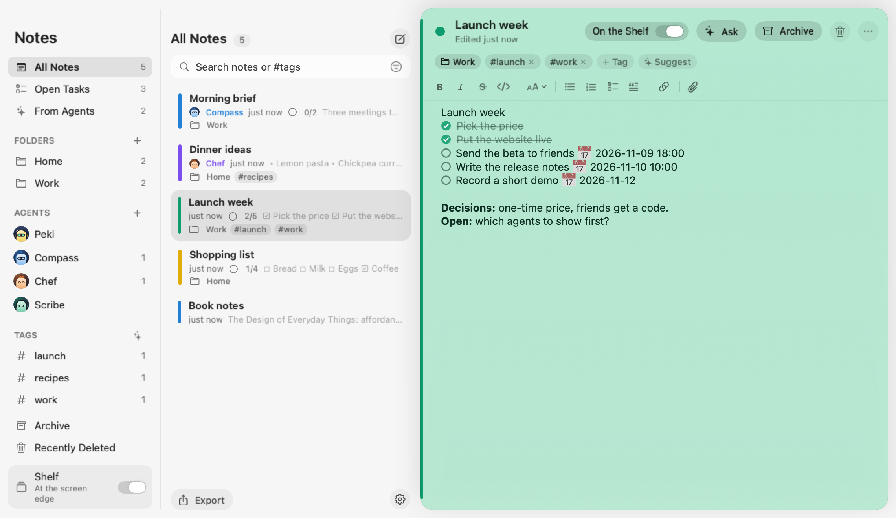

<table>
<tr>
<td width="33%" valign="top"><b>Folders and tags</b> Drag notes into folders. Tag suggestions come from the on-device model.</td>
<td width="33%" valign="top"><b>Search that understands</b> All your words, "exact phrases", #tags and -exclusions, with the matching line highlighted.</td>
<td width="33%" valign="top"><b>Formatting as you type</b> Bold, lists, headings and links with the usual shortcuts; the marks stay out of sight.</td>
</tr>
</table>

##  And a lot more from the last month

<table>
<tr>
<td width="33%" valign="top"><b>Peki sets itself up</b> Tell the notes agent "switch to the dark theme" or "add the Notion connection". Every change shows an approval card first and can be undone.</td>
<td width="33%" valign="top"><b>Welcome and "You"</b> Peki asks your name, how to address you and what you're into, then suggests agents for it. Change it later in Settings → You.</td>
<td width="33%" valign="top"><b>Its cursor in the browser</b> An agent browsing through the Playwright connection shows a cursor with its face on the page, so you see who's clicking where.</td>
</tr>
<tr>
<td width="33%" valign="top"><b>Drop onto the menu bar</b> Drag a file, image or text near Peki and drop it on an agent's face to add it to that chat, or on "New note".</td>
<td width="33%" valign="top"><b>Folders, with your OK</b> Ask about a folder on your Desktop and the agent asks once: always, once or no, for reading or for changing files.</td>
<td width="33%" valign="top"><b>Agents that know each other</b> Each agent sees the others' connections and skills and hands work to the one that can do it.</td>
</tr>
<tr>
<td width="33%" valign="top"><b>Quicker hands-free</b> Your words are transcribed while you speak and the reply starts as soon as you stop. Whisper runs on the Neural Engine.</td>
<td width="33%" valign="top"><b>Copy and columns</b> Copy a reply with its formatting, a code block or a table. Hide the sidebar in the Notes window or show only the note.</td>
<td width="33%" valign="top"><b>Chat history and search</b> Each chat keeps 1,000 messages. Search it, or export it to Markdown, from the "…" menu.</td>
</tr>
<tr>
<td width="33%" valign="top"><b>Automatic backup</b> Notes, agents and jobs, daily or weekly, to a folder you pick, like iCloud Drive. Deleted notes wait 7 days.</td>
<td width="33%" valign="top"><b>Shortcuts and Services</b> "Ask Agent", "Add Task" and "Create Note" in Shortcuts and Siri. Turn text selected in any app into a note.</td>
<td width="33%" valign="top"><b>Share an agent</b> Duplicate it, or export a <code>.pekiagent</code> file. An imported agent starts with no permissions until you turn them on.</td>
</tr>
</table>

Every change, release by release: [release notes](https://github.com/erdogankesgin/pekiapp/releases).

##  Private by default

**No server, no account, no tracking.** Your notes are encrypted on your Mac, and nothing leaves it unless you turn a
feature on.

- **On-device first.** The default model runs on your Mac. Cloud models stay off until you add a key.
- **You see what leaves.** Internet, connections and cloud models are per agent, and each agent's header says when
  they're on.
- **No tracking, anywhere.** No analytics in the app, and the website sets no cookies.

Details, feature by feature: [privacy policy](https://getpeki.app/privacy/).

## Try it for 14 days. Then pay once.

No subscription. Your notes, the Shelf and your tasks keep working whatever you decide.

<table>
<tr>
<th width="50%" align="left">Free trial · $0 for 14 days</th>
<th width="50%" align="left">Peki Pro · $39 one-time</th>
</tr>
<tr>
<td valign="top">✓ Every agent, model and connection ✓ Jobs, voice and meeting notes ✓ No account, no card  <a href="https://getpeki.app/download"><b>Download Peki</b></a></td>
<td valign="top">✓ Agents keep working after the trial ✓ Up to 3 of your Macs ✓ Move it to a new Mac anytime  <a href="https://buy.polar.sh/polar_cl_GgE9EWSvq7ehGqo7WuTpyHnDneS0aQD5e9H0b4fJMkV"><b>Buy Peki Pro</b></a></td>
</tr>
</table>

Checkout by Polar, our payment provider. Your license key arrives by email.

## Install

1. Download the DMG from [getpeki.app/download](https://getpeki.app/download) or the
   [latest release](https://github.com/erdogankesgin/pekiapp/releases/latest).
2. Open it and drag Peki to Applications.
3. Open Peki. It lives in your menu bar, and the Shelf waits at the edge of your screen.

Peki is signed with Developer ID and notarized by Apple, and it can update itself (Settings → General → Updates).
Each release lists the DMG's SHA-256.

## Questions

<b>What do I need?</b>

 
A Mac with Apple silicon and macOS 26 or later. The on-device model needs Apple Intelligence turned on.

<b>What happens after the trial?</b>

 
Your notes, the Shelf, tasks and reminders keep working. Chatting with agents and their jobs need Peki Pro.

<b>Do I need an API key?</b>

 
No. Peki works with Apple's on-device model out of the box. Keys, local servers and subscriptions are optional, per agent.

<b>Can I use Peki Pro on more than one Mac?</b>

 
Yes, on up to three. To move it, choose "Remove from This Mac…" in Settings → General → Peki Pro.

<b>Is Peki always listening?</b>

 
No. The microphone turns on only when you record or start a hands-free conversation, and macOS shows its orange
indicator. Speech is transcribed on your Mac; in hands-free mode only what starts with the agent's name goes to the agent.

<b>Can an agent control my Mac?</b>

 
Only if you turn on "Computer" for that agent; it's off by default and needs the Accessibility permission. It asks before
deleting, sending or buying, never touches password fields, and you can limit it to the apps you pick.

<b>Where is my data?</b>

 
On your Mac. Peki has no server; the <a href="https://getpeki.app/privacy/">privacy policy</a> lists every feature
that sends data, and where.

<b>Which languages does Peki speak?</b>

 
Peki's interface is in English, Turkish, German, French, Spanish, Japanese and Simplified Chinese.

## Feedback

Found a bug or have an idea? [Open an issue](https://github.com/erdogankesgin/pekiapp/issues), or write to
[destek@getpeki.app](mailto:destek@getpeki.app) ([getpeki.app/support](https://getpeki.app/support/)).

> [!WARNING]
> Issues are public. Please don't paste private notes or API keys into one.

## About this repository

This is Peki's public home on GitHub: release downloads and release notes. Peki is closed source, so the app's code
isn't published here.

Peki includes or downloads open-source components: [Noty](https://github.com/aimen08/noty) (the Shelf and the note
editor are adapted from it), [whisper.cpp](https://github.com/ggml-org/whisper.cpp) with OpenAI's Whisper model and
Silero VAD, and [Sparkle](https://sparkle-project.org). Their licenses are in the app's About window.

 

  

<h3 align="center">Ready when you are.</h3>

  

Free for 14 days · macOS 26 or later · Apple silicon © 2026 Erdoğan Kesgin. All rights reserved.

