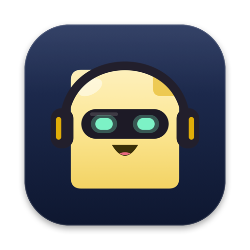
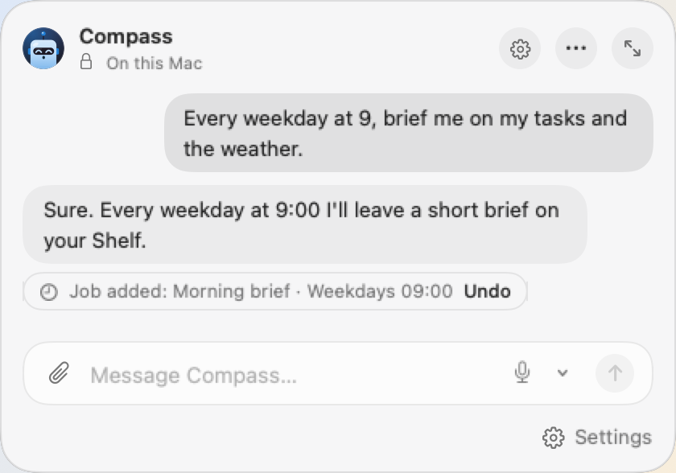
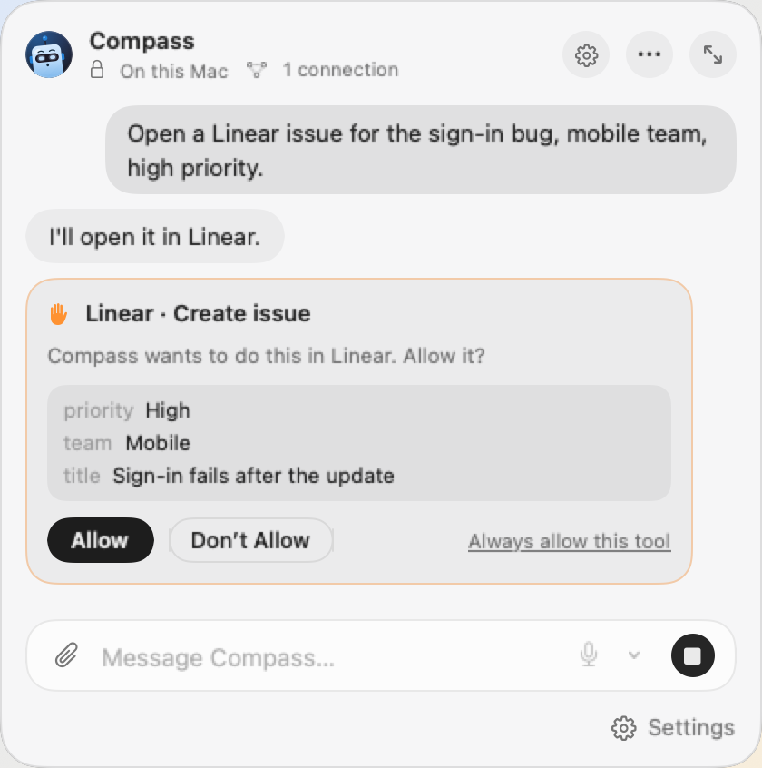
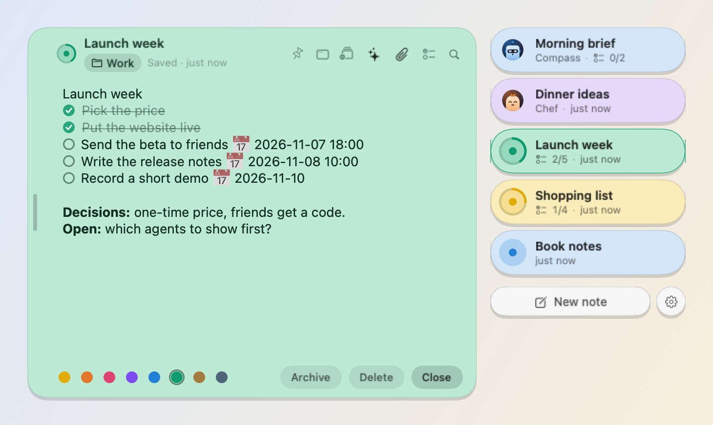
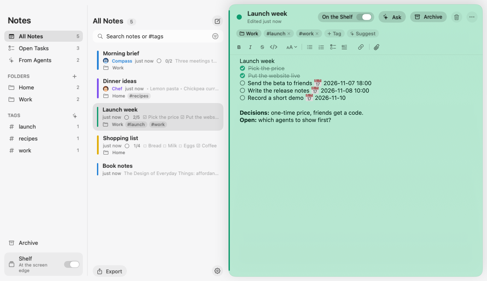

  

<h1 align="center">Peki</h1>

  <b>Personal AI agents, right in your Mac's menu bar.</b> 
  Give each agent a name, a face and a job. They work with your notes, only as much as you allow,
  and run on your Mac by default.

  <a href="https://getpeki.app/download"><b>Download for Mac</b></a> ·
  <a href="https://getpeki.app">getpeki.app</a> ·
  <a href="https://github.com/erdogankesgin/pekiapp/releases">Releases</a> ·
  <a href="README.tr.md">Türkçe</a>

Free for 14 days · macOS 26 or later · Apple silicon

  

## What Peki does

- **Agents with a name, a face and a job.** Describe one in a sentence and Peki suggests a name, a personality
  and a face. It keeps that role, remembers what matters and works with the tools you allow.
- **Hand off the routine.** "Every weekday at 9, brief me" sets up the job; "make it 10" moves it. Agents work on
  a schedule or when you ask, and leave the result as a sticky note on your Shelf.
- **Notes, only as you allow.** No access, read, or read and change. Every change shows up in the chat with an Undo.
- **Internet, skills and connections.** Web search, Agent Skills and MCP servers like Notion, Linear or Figma,
  turned on per agent. A tool that changes something waits for your OK.
- **Meeting notes.** Record a meeting. It is transcribed on your Mac, and an agent writes down the decisions and
  action items.
- **Your model, your choice.** Apple's on-device model out of the box. Or Ollama and LM Studio on your network,
  Claude, OpenAI and Gemini with your own key, Claude Code, Codex, Cursor and more with the subscription you
  already have. Every agent can use a different one.

  

## Your notes, at the edge of your screen

The Shelf is a slim glass strip at the side of your screen. Point at it and your notes slide out; your agents'
results land there too. A line that starts with `- [ ]` is a task, and "tomorrow at 10" becomes a reminder.
Record audio straight into a note, or add PDFs and images.

  

The Notes window has folders, tags and search for when the Shelf isn't enough, and you can ask an agent about the
note you're reading, right next to it.

  

## Private by default

No server, no account, no tracking. Your notes are encrypted on your Mac, and nothing leaves it unless you turn a
feature on. Internet, connections and cloud models are per agent, and each agent's header says when they're on.
Details: [privacy policy](https://getpeki.app/privacy/).

## Price

Try everything free for 14 days, no account or card. **Peki Pro** is a one-time $39 for up to three of your Macs.
Whatever you decide, your notes, the Shelf, tasks and reminders keep working; chatting with agents and their jobs
need Peki Pro.

## Install

1. Download the DMG from [getpeki.app/download](https://getpeki.app/download) or the
   [latest release](https://github.com/erdogankesgin/pekiapp/releases/latest).
2. Open it and drag Peki to Applications.

Peki is signed with Developer ID and notarized by Apple. It can check for updates itself
(Settings → General → Updates). Each release lists the DMG's SHA-256.

Needs a Mac with Apple silicon and macOS 26 or later. The on-device model needs Apple Intelligence turned on.

## About this repository

This is Peki's public home on GitHub: release downloads and release notes. Peki is closed source, so the app's
code isn't published here.

Questions, problems or ideas: [destek@getpeki.app](mailto:destek@getpeki.app) ·
[getpeki.app/support](https://getpeki.app/support/)

Peki includes or downloads open-source components: [Noty](https://github.com/aimen08/noty) (the Shelf and the
note editor are adapted from it), [whisper.cpp](https://github.com/ggml-org/whisper.cpp) with OpenAI's Whisper
model and Silero VAD, and [Sparkle](https://sparkle-project.org). Their licenses are in the app's About window.

© 2026 Erdoğan Kesgin. All rights reserved.
