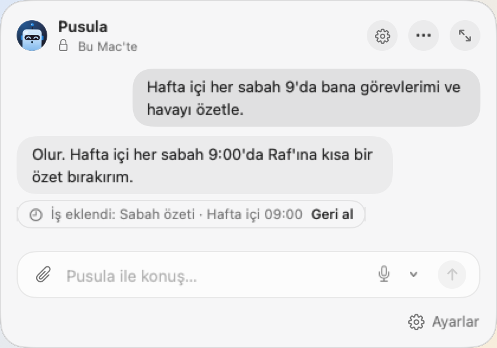
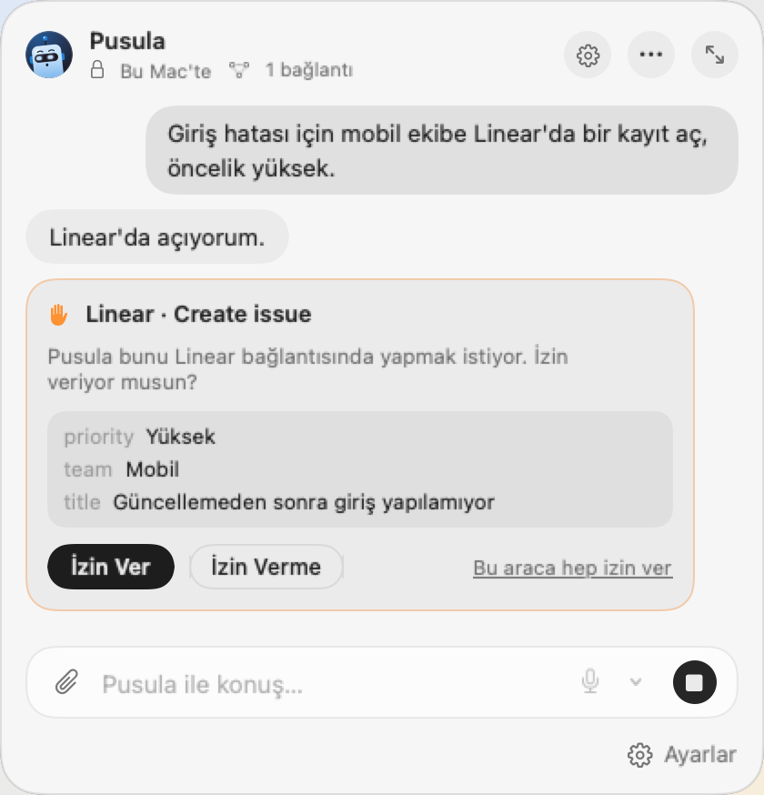
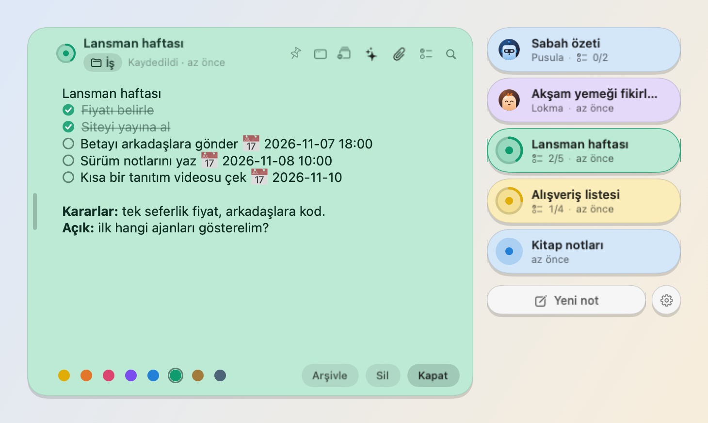
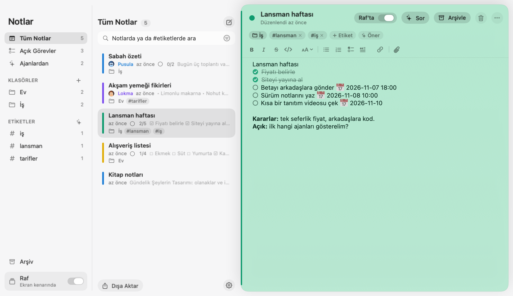

  

<h1 align="center">Peki</h1>

  <b>Kişisel yapay zekâ ajanların, Mac'inin menü çubuğunda.</b> 
  Her ajana bir ad, bir yüz ve bir iş ver. Notlarını yalnızca izin verdiğin kadar görürler 
  ve varsayılan olarak Mac'inde çalışırlar.

  <a href="https://getpeki.app/download"><b>Mac için indir</b></a> ·
  <a href="https://getpeki.app/tr/">getpeki.app</a> ·
  <a href="https://github.com/erdogankesgin/pekiapp/releases">Sürümler</a> ·
  <a href="README.md">English</a>

14 gün ücretsiz · macOS 26 ve üstü · Apple Silicon

  

## Peki ne yapar

- **Adı, yüzü ve işi olan ajanlar.** Ajanı bir cümleyle anlat; Peki bir ad, bir kişilik ve bir yüz önersin. Ajan o
  rolü korur, önemli olanı hatırlar ve izin verdiğin araçlarla çalışır.
- **Rutin işleri devret.** "Hafta içi her sabah 9'da bana özet geç" işi kurar, "10'a al" saatini değiştirir. Ajanlar
  bir takvime göre ya da sen isteyince çalışır, sonucu Raf'ına yapışkan not olarak bırakır.
- **Notlara izin verdiğin kadar.** Erişemez, okur ya da okur ve değiştirir. Her değişiklik sohbette Geri al ile görünür.
- **İnternet, beceriler ve bağlantılar.** Web araması, Agent Skills ve Notion, Linear, Figma gibi MCP sunucuları;
  ajan başına açılır. Bir şeyi değiştiren araç onayını bekler.
- **Toplantı notları.** Toplantıyı kaydet. Bu Mac'te yazıya çevrilir, bir ajan kararları ve yapılacakları çıkarır.
- **Model senin seçimin.** Apple'ın cihaz üstü modeliyle hemen çalışır. İstersen kendi ağında Ollama ve LM Studio,
  kendi anahtarınla Claude, OpenAI ve Gemini, zaten ödediğin abonelikle Claude Code, Codex, Cursor ve dahası.
  Her ajan ayrı bir model kullanabilir.

  

## Notların, ekranının kenarında

Raf, ekranının kenarında ince bir cam şerit. Üzerine gel, notların kayarak çıksın; ajanlarının sonuçları da buraya
düşer. `- [ ]` ile başlayan satır görevdir, "yarın 10'da" yazarsan hatırlatmaya döner. Nota doğrudan ses kaydet ya da
PDF, resim ekle.

  

Raf'ın yetmediği yerde Notlar penceresinde klasörler, etiketler ve arama var; okuduğun not hakkında hemen yanında
bir ajana sorabilirsin.

  

## Varsayılan olarak gizli

Sunucu yok, hesap yok, izleme yok. Notların Mac'inde şifreli durur; sen bir özelliği açmadıkça hiçbir şey dışarı
çıkmaz. İnternet, bağlantılar ve bulut modelleri ajan başına açılır; açıkken ajanın başlığında yazar.
Ayrıntı: [gizlilik politikası](https://getpeki.app/tr/privacy/).

## Fiyat

14 gün her şeyi ücretsiz dene; hesap yok, kart yok. **Peki Pro** tek seferlik 39 $, en çok üç Mac'inde. Ne karar
verirsen ver, notların, Raf, görevler ve hatırlatmalar çalışmaya devam eder; ajanlarla sohbet ve ajanların işleri
için Peki Pro gerekir.

## Kurulum

1. DMG'yi [getpeki.app/download](https://getpeki.app/download) adresinden ya da
   [son sürümden](https://github.com/erdogankesgin/pekiapp/releases/latest) indir.
2. Aç ve Peki'yi Uygulamalar klasörüne sürükle.

Peki Developer ID ile imzalı ve Apple onaylı. Güncellemeleri kendisi denetleyebilir (Ayarlar → Genel → Güncellemeler).
Her sürümde DMG'nin SHA-256'sı yazar.

Apple Silicon işlemcili, macOS 26 ya da üstü bir Mac gerekir. Cihaz üstü model için Apple Intelligence açık olmalı.

## Bu depo hakkında

Burası Peki'nin GitHub'daki herkese açık sayfası: sürüm indirmeleri ve sürüm notları. Peki kapalı kaynak; uygulamanın
kodu burada yayınlanmaz.

Soru, sorun ya da öneri: [destek@getpeki.app](mailto:destek@getpeki.app) ·
[getpeki.app/tr/support](https://getpeki.app/tr/support/)

Peki şu açık kaynak bileşenleri içerir ya da indirir: [Noty](https://github.com/aimen08/noty) (Raf ve not
düzenleyicisi ondan uyarlandı), OpenAI'nin Whisper modeli ve Silero VAD ile
[whisper.cpp](https://github.com/ggml-org/whisper.cpp), [Sparkle](https://sparkle-project.org). Lisansları uygulamada
Peki Hakkında penceresinde.

© 2026 Erdoğan Kesgin. Tüm hakları saklıdır.
